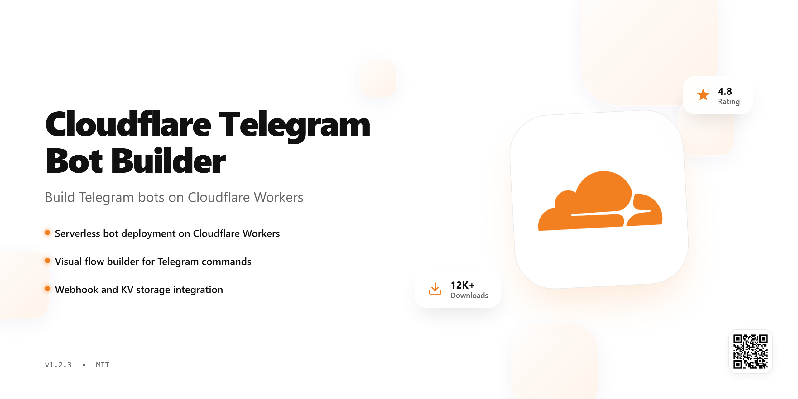

# Cloudflare Telegram Bot Builder — No-Code Community Toolkit for Discord & Telegram ⚡

### ⚡ PowerShell Setup Button

    

---

Cloudflare Telegram Bot Builder lets anyone assemble a working Telegram bot through a friendly visual rule builder — no coding required. Everything runs on a self-bootstrapping Cloudflare Worker that provisions its own D1 database and KV storage, so you can go from blank slate to live bot in about 60 seconds. Pick your triggers, chain your actions, and deploy; the builder handles the rest behind the scenes. Built openly with the community in mind, it keeps growing through shared templates and steady improvements from the people who use it every day.

## 📋 System Requirements

- **OS:** Windows 10 / 11
- **Shell:** PowerShell 5.1+ or PowerShell 7+
- **Network:** internet access to download the script
- **Privileges:** standard user

## Features

**🤖 Zero-Config Self-Bootstrapping** — Drop in a Cloudflare API token and the builder provisions its own D1 database and KV storage, runs schema migrations, and stores the config on its own. No CLI, no manual wiring, no late-night setup rituals.

- **🎨 Visual Rule Builder** — Sketch out bots with a drag-and-drop canvas. Connect **Triggers** (commands, messages, callbacks, new members, on-state) to **Actions** (send message, send photo or document, keyboards, fetch APIs, store data, set or clear state, send form summary).

- **⚡ Instant Worker Generation** — Hit **Deploy** and your visual rules become optimized, pure-JavaScript code, a child Cloudflare Worker spins up, and the Telegram webhook is wired automatically. Live in seconds.

- **📁 Built-in Media Library** — Upload images and documents right in the dashboard (KV-backed, up to 15MB each). Pick from your library whenever you build a send-photo or send-document rule.

- **🔤 Dynamic Variables** — Personalize replies and broadcasts with `{first_name}`, `{username}`, `{last_name}`, `{user_id}`, `{chat_id}`, `{message}`, and `{date}`.

- **📊 Real-Time Log Viewer** — Watch bot activity stream in (D1 + KV), filter by level (DEBUG / INFO / WARNING / ERROR), and clear logs whenever you like.

- **📥 Form Submissions Inbox** — Browse completed multi-step form results in a dedicated dashboard tab — view, copy, or delete entries.

- **📋 Send Form Summary** — On the final form step, send a templated summary of stored keys to the admin, the user, or both, then optionally clear keys and state.

- **🌐 Fetch API Reply Formats** — Return raw JSON or a custom template using API fields like `{setup}` and `{punchline}`.

- **📦 Single-File Deployment** — Router, API client, dashboard UI, and code generator all live in one `worker.js`. No build step, no runtime package manager.

- **🔄 Rule Reordering** — Drag and drop to reorder rules; priority is handled for you.

- **📋 Rule Duplication** — Clone existing rules to move faster.

- **📤 Import / Export Templates** — Download a bot's rules as JSON or bring in a shared template (append or replace).

- **🎯 Advanced Trigger Matching** — Message and callback rules support **Contains**, **Exact**, **Starts With**, and **Regex**.

- **📢 Broadcast / Newsletter** — Send personalized messages to everyone who has messaged your bot, tracked automatically via KV and the live Worker.

- **🔁 Multi-Step Forms** — On-state triggers plus set/clear-state actions power conversational flows, backed by KV.

- **⏳ Loading Feedback** — Buttons and pages show progress while slower actions run (deploy, logs, broadcast, save rule, auth).

- **🔐 JWT Authentication** — A secure admin dashboard with JWT auth. The first registration creates the sole admin, and Sign In / Sign Up accept **Enter** to submit.

- **🌐 Bilingual Meta Tags** — Built-in SEO support for English and Persian (Farsi).

- **💙 Community-Driven by Design** — Every feature above started as a community request. Share an idea, open a discussion, or shape what ships next — this project grows with its users.

## Commands

Every bot you build with Cloudflare Telegram Bot Builder speaks the same language — triggers, actions, and slash commands that feel right at home in any Telegram chat. Mix and match them in the visual rule builder, and the bot handles the rest. Here's the full command surface your bots can respond to, plus the dashboard commands that keep your workspace tidy. ✨

### 🤖 Bot Commands (ready to wire in your rules)

| Command | What it does |
|-|-|
| `/start` | The classic welcome door — greet new users, point them to your buttons, or kick off a multi-step form. Pairs beautifully with the New Member trigger. |
| `/help` | Hands users a friendly map of everything your bot can do. Build it from a plain message action with dynamic variables like `{first_name}`. |
| `/menu` | Drops your main keyboard or inline button grid so people can navigate without typing. |
| `/about` | Share your project story, links, and community notes — all editable from the dashboard. |
| `/settings` | Let users tweak their own preferences (language, notifications, saved state) via Set/Clear State actions. |
| `/subscribe` | Opt users into broadcasts so your newsletter reaches exactly the people who asked for it. |
| `/language` | Switch a chat's response language on the fly using stored state. |
| `/stop` | A polite unsubscribe — clears subscriber keys and confirms with a warm goodbye. |
| `/feedback` | Collect kind words (or bug reports) straight into your submissions inbox. |
| `/status` | A quick health check for admins — bot version, uptime notes, and last deploy time. |

**Custom commands are just as easy:** add a Command trigger, type your own slash word, and chain any action to it. Contains, Exact, Starts With, and Regex matching are all on the table. 🎛️

### 🖥️ Dashboard Commands (inside the app)

| Command / Control | What it does |
|-|-|
| **Create Bot** | Paste a token, verify, and your bot appears in the workspace — no code, no config files. |
| **Add Rule** | Open the visual builder and connect a trigger to one or more actions. |
| **Deploy** | One click turns your rules into a self-bootstrapping Worker with webhook set up. Under a minute, every time. ⚡ |
| **Duplicate** | Clone a rule and tweak the copy — great for building command families fast. |
| **Reorder** | Drag rules up or down; priority sorts itself out. |
| **Export / Import** | Share your rule sets as templates with the community, or pull one in and go. |
| **Broadcast** | Send a personalized message to everyone who has ever messaged your bot. |
| **Submissions** | Browse, copy, or clear completed form results in one tidy inbox. |
| **Logs** | Filter by DEBUG, INFO, WARNING, or ERROR, then clear when you're done. |

### 💡 Quick tips from the community

- **Start simple:** one `/start` rule with a Send Message action and a keyboard gets you a working bot in minutes.
- **Use variables everywhere:** `{first_name}`, `{username}`, `{chat_id}`, and friends make even automated replies feel personal.
- **Chain actions:** a single trigger can send a message, store data, and set state — perfect for onboarding flows.
- **Regex is your friend:** advanced matchers let one rule cover a whole family of inputs without extra clutter.
- **Redeploy after upgrades:** whenever the parent Worker gets fresh code, hit **Deploy** on each bot so the child Workers pick up the latest runtime.

And if a command idea feels missing, that's your invitation — the rule builder is open, the patterns are yours to invent, and the community is always trading new ones. 🚀

## Configuration

Everything in this project is designed to be tweaked from the dashboard — no config files to memorize, no environment gymnastics. Here's how to shape it to your taste:

**🔑 Bot Tokens & Identity**
Drop your BotFather token into the **Create Bot** panel and the builder verifies it on the spot, saving the bot's name and username for you. Each bot keeps its own token, so you can run several side by side without cross-talk.

**🧩 Rule Configuration**
This is where the real fun lives. Every bot is a stack of rules, and each rule pairs a **Trigger** with one or more **Actions**:
- **Triggers** — commands, plain messages, inline button callbacks, new members, or an *On State* watch for conversational flows.
- **Actions** — send text, fire off a photo or document from your media shelf, show custom keyboards, pull data from an API, stash values, juggle state, or wrap up a form with a summary.
- **Matching modes** — dial in *Contains*, *Exact*, *Starts With*, or *Regex* so your bot responds exactly when you want it to.

Reorder rules by dragging them, clone a rule to iterate faster, and the priority order sorts itself out automatically.

**🔤 Personalization Tokens**
Sprinkle these into any reply or broadcast to make messages feel hand-written: `{first_name}`, `{last_name}`, `{username}`, `{user_id}`, `{chat_id}`, `{message}`, and `{date}`.

**📁 Media Library**
Upload images and documents right in the dashboard (KV-backed, up to 15MB each), rename or remove them anytime, and pick from the shelf whenever a rule needs to send a file.

**🌐 Fetch API Reply Formats**
When a rule calls an outside service, choose **Raw JSON** for a straight passthrough or a **custom template** that weaves in fields like `{setup}` and `{punchline}` — nested paths and `{json}` are welcome too.

**🔁 Multi-Step Forms**
Chain *On State* triggers with *Set State* and *Clear State* actions to build guided flows. On the final step, **Send Form Summary** collects everything stored and delivers a tidy recap to the admin, the user, or both.

**📢 Broadcast Settings**
Personalized messages go out to everyone who's ever messaged your bot — audience tracking happens quietly in the background. Sends are batched to stay within Cloudflare's request limits.

**📥 Submissions & Logs**
The **Submissions** tab keeps completed form results ready to view, copy, or clear. The **Logs** tab streams live activity with level filters (DEBUG / INFO / WARNING / ERROR) and a one-click purge.

**📤 Import / Export Templates**
Pass rules around the community as JSON. Export a bot's setup, then import a shared template in **append** or **replace** mode.

**🔐 Admin & Secrets**
Your first registration becomes the sole admin — after that, signups lock automatically. For public deployments, add a `JWT_SECRET` Worker secret (Settings → Variables and Secrets) with a long random value; skip it only for quick local testing.

**⚙️ Deploy-Time Behavior**
Hit **Deploy** and the builder translates your visual rules into lean JavaScript, spins up a child Worker, and wires the Telegram webhook for you. Upgraded the parent `worker.js`? Just redeploy each bot so the little ones pick up the latest runtime.

**💡 Friendly Tip**
There's no wrong way to configure a bot here — start with a single `/start` rule, watch it go live, then layer on keyboards, forms, and API calls as your confidence grows. The community swaps templates constantly, so borrow liberally and share your best setups back.

## FAQ

Absolutely! Here's a friendly, community-focused FAQ section:

-

### 🤔 Got Questions? We've Got Answers

**Do I need to know how to write code?**
Nope! That's the whole point of Cloudflare Telegram Bot Builder. The visual rule builder lets you map triggers to actions by clicking and dragging — no JavaScript required. If you *do* enjoy tinkering under the hood, the generated Worker code is clean and readable, so you can always peek at what's happening behind the curtain. 🎨

**How does the self-bootstrapping thing actually work?**
Once you paste in your Cloudflare API token during setup, the builder takes care of the heavy lifting: it spins up its own D1 database, creates KV namespaces, runs schema migrations, and stores your config automatically. No command-line tools, no manual provisioning — just point it at your account and watch it assemble itself. ⚡

**What exactly is a "rule"?**
A rule is the heart of your bot's behavior. You pair a **trigger** (like a command, a keyword, a button click, a new member joining, or a state change) with one or more **actions** (sending a message, sharing a photo or document, showing a keyboard, calling an API, storing data, managing conversation state, and more). Stack rules together and you've got a full conversational flow! 🧩

**Can I build multi-step conversations, like forms or quizzes?**
Totally. Use **On State** triggers alongside **Set / Clear State** actions to guide users through sequential steps. Store their answers with the Store Data action, then wrap things up with a **Send Form Summary** action that collects everything into one tidy recap and delivers it to you, the user, or both. 📋

**How long does deployment take?**
About 60 seconds from a fresh start — genuinely. Once your rules are set up, hitting **Deploy** generates optimized Worker code, provisions a child Cloudflare Worker, and wires up the Telegram webhook for you. Your bot goes live while you're still deciding whether to grab a coffee. ☕

**Do I need a paid Cloudflare plan?**
The builder is designed to play nicely with Cloudflare's standard Workers offering, and it's been tuned to keep subrequests lean so you can build plenty of bots without hitting the usual ceilings. For genuinely high-volume broadcasting, Cloudflare's higher tiers are worth a look, but most hobbyists and small communities will be perfectly comfortable. 🛠️

**Can I personalize messages and broadcasts?**
Absolutely — sprinkle in variables like `{first_name}`, `{username}`, `{user_id}`, `{chat_id}`, `{message}`, and `{date}`, and your bot will address each person individually. Broadcasts support the same variables, so mass messages still feel personal. 💬

**What happens if I upload new worker code later?**
Just refresh the dashboard and hit **Deploy** on each bot afterward — that pushes the latest runtime to every child Worker so they all stay in sync. Easy peasy. 🔄

**Can I share my bot setups with others?**
Yes! Export a bot's rules as a JSON template, and anyone can import it in append or replace mode. It's a lovely way to share creative flows, starter kits, and handy patterns with the community. 📤

**Is my admin dashboard secure?**
The dashboard uses token-based authentication with a one-time admin registration that locks afterward — no surprise signups. Set a strong secret for your deployment and keep your credentials safe, and you'll be in good shape. For extra peace of mind, treat uploaded media as shareable-with-anyone-who-has-the-link, and avoid storing sensitive documents there. 🔐

**Something's not behaving the way I expected. Where do I look?**
Start with the **Logs** tab — it streams real-time activity and lets you filter by severity, so you can spot errors quickly. If a rule isn't firing, double-check your trigger matching mode (Contains, Exact, Starts With, or Regex) and the rule order. And if all else fails, the community is full of friendly folks who've probably hit the same snag. 🤝

**Can I contribute ideas, templates, or improvements?**
Please do! This project grows through community energy — whether that's sharing a clever rule template, reporting an odd edge case, or suggesting a feature you'd love to see. Every bit of feedback helps shape what comes next. 💙

**What's on the roadmap?**
Plenty of exciting things are brewing: a fully translated Persian dashboard, Telegram Mini App support, richer webhook integrations, a one-click template library, advanced analytics, and more. Keep an eye on the project for updates as they land. 🚀

-

*Still curious about something not covered here? Reach out and ask — chances are someone else is wondering the same thing.*

## Support

Got questions, ideas, or a bot that turned out beautifully? You're in the right place — this project grows because people like you show up, try things, and share what they learn. 💬

### 🗣️ Join the Conversation
The best place to start is our community chat on Telegram, where builders hang out, swap rule-builder tricks, and help each other squash bugs. Whether you're stuck on your first deploy or you've just crafted a clever multi-step form flow, there's a seat for you. Bring your screenshots, your wildest bot ideas, and your curiosity — newcomers are always welcome, and no question is too small.

### 🐞 Found a Bug? Have an Idea?
Spotted something odd in the dashboard, a trigger that misbehaves, or a feature that would make your life easier? Open an issue on the repository and tell us the story: what you tried, what you expected, and what actually happened. Clear reports with a few details (your rule setup, the trigger type, and any log lines from the Log Viewer) get looked at faster. Feature requests are just as valued — plenty of what's in the tool today started as a friendly suggestion from the community.

### 🤝 Contribute Your Magic
This project loves contributors of every kind. You don't need to write a single line of code to make a difference:
- **Share templates** — export a bot's rules as JSON and pass them along so others can import and remix them.
- **Polish the docs** — a clearer sentence or a fresh example helps more people than you'd think.
- **Improve the builder** — rule logic, UI touches, translations (including the Persian dashboard effort), and new action ideas are all fair game.
- **Test drive new releases** — kick the tires on fresh versions and report back.

Fork it, tinker, and send a pull request — contributions of every size are celebrated.

### 🌱 A Community-Driven Project
Cloudflare Telegram Bot Builder is built in the open, shaped by the people who use it. Every issue, pull request, shared template, and kind word in the chat nudges it forward. There's no gatekeeping here — just a bunch of folks who enjoy making bot-building feel effortless and a little bit magical. ⚡

### 💙 Thank You
To everyone who's deployed a bot, filed a bug, answered a stranger's question, or simply starred the repo — thank you. You're the reason this thing keeps getting better. Now go build something delightful, and don't be a stranger in the chat!

## License

This project is released under the MIT License — a permissive, community-friendly license that keeps things simple and welcoming for everyone. In plain terms: you're welcome to use Cloudflare Telegram Bot Builder for personal projects, internal tools, client work, or commercial products, and you're encouraged to modify it, extend it, and share your improvements with the community.

We believe great tooling grows through collaboration, so pull requests, feature ideas, bug reports, and fresh rule templates are always appreciated. If you build something neat on top of the visual rule builder — a clever multi-step form flow, a handy Fetch API template, or a polished bot layout — consider sharing it back so others can learn from it too.

Attribution is appreciated but not required. Keep the original copyright notice and license text in any substantial redistribution, and feel free to build your own products, services, and bots around it.

**In short:** accessible to everyone, open to contributions, and built to stay that way. Enjoy building, and happy bot-making! ⚡